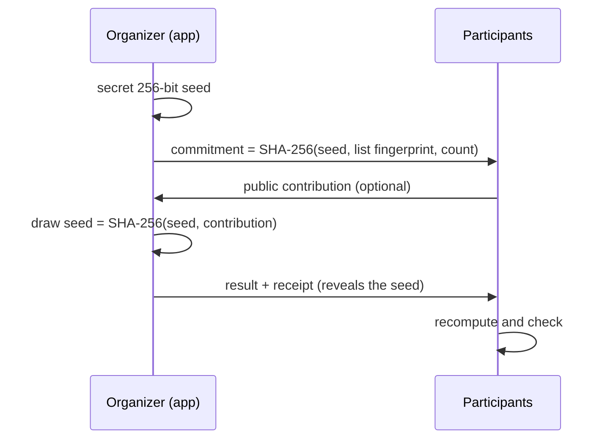

# Sorteador

[Português](README.md) · **English** · [Open Sorteador](https://acamilateixeira.github.io/sorteador-web/)

[](https://github.com/acamilateixeira/sorteador-web/actions/workflows/pages.yml)

**A browser-based name and number draw that can be audited.** In a regular draw, participants have to trust the organizer. Here the organizer publishes a commitment before drawing, and anyone can later use the receipt to check that the list, the count, and the result were not changed.

`Angular 22` · `TypeScript` · `Signals` · `Web Crypto (SHA-256)` · `Vitest` · `GitHub Actions`

The interface is in Portuguese. Labels are translated in parentheses below.

## How to use it

1. Pick **Nomes** (Names) and paste one name per line, or pick **Números** (Numbers) and enter a range.
2. Set how many results each round returns. Results within a round are always distinct.
3. Keep **Excluir resultados anteriores deste conjunto** (exclude previous results) checked to keep drawing from the same list without repeats. **Nova sequência** (new sequence) clears the result and the history.
4. Click **Sortear agora** (draw now). Previous rounds stay in the result panel while the page is open.

### With an audit

1. Check **Sorteio auditável** (auditable draw) and click **Gerar compromisso** (generate commitment).
2. Share the commitment code with participants, for example on screen or in a chat.
3. Ask someone in the audience for a word or a number and type it in **Contribuição dos participantes** (participants' contribution).
4. Click **Sortear e revelar** (draw and reveal). The result comes with a receipt that you can copy as a link or download as JSON.
5. Anyone who wants to check opens the link or pastes the receipt in **03 / Verificação** (verification).

## How the audit works



- **Commitment.** It binds the list and the count before the draw. If either changes afterwards, the app discards the commitment and asks for a new one.
- **Public contribution.** The seed is generated in the organizer's browser, so the organizer could generate commitments until one gives a convenient result. The contribution arrives after the commitment is published and goes into the seed, which rules that out.
- **Deterministic draw.** `SHA-256(seed:counter)` blocks become 32-bit integers. Values that would cause modulo bias are discarded, and the integers feed a partial Fisher-Yates shuffle. The same seed always produces the same result.
- **Verification.** The app recomputes everything from the receipt and shows two checks:

| Tampering | What verification reports |
| --- | --- |
| List, count, or seed changed | The commitment does not match |
| Contribution or result changed | Re-running the draw gives a different result |

### Audit limits

- The commitment only helps if it is shared **before** the draw.
- The contribution has to come from someone other than the organizer.
- **The receipt contains the whole list.** Only share the link where the list can be public. The receipt lives in the URL fragment (`#`), which the browser never sends to the server, but it stays in browser history and anywhere the link is pasted.
- Large lists do not fit in a link (8,000-character limit). In that case, use **Baixar comprovante** (download receipt) and share the file.

## Architecture

| Part | Responsibility |
| --- | --- |
| [`src/app/draw.ts`](src/app/draw.ts) | Input rules (up to 5,000 names, ranges up to 100,000 numbers, up to 200 per round) and the regular draw with `crypto.getRandomValues`, without modulo bias. |
| [`src/app/audit.ts`](src/app/audit.ts) | Commitment, contribution, deterministic draw, receipt, link, and verification. Web Crypto only, no dependencies. |
| [`src/app/app.ts`](src/app/app.ts) | Angular component with Reactive Forms and signals. It handles rounds, result exclusion, the two audit steps, and the verification panel. |
| [`.github/workflows/pages.yml`](.github/workflows/pages.yml) | Runs tests and the build on every PR and deploys to GitHub Pages on every merge to `main`. |

Everything runs in the browser. The page is served as static files, and lists and results never leave the device unless you share the receipt.

## Tests

The project has 18 Vitest tests:

- **Input rules and the regular draw:** duplicate names and empty lines, invalid ranges, and impossible counts.
- **Audit engine:**
  - a fixed reference vector, so old receipts stay verifiable;
  - uniformity of the draw;
  - the contribution changing the seed;
  - receipts surviving the link round trip;
  - one case for each kind of tampering.
- **Component:**
  - rounds without repeats;
  - the remaining-options message;
  - the commit-and-reveal flow;
  - the commitment being discarded when the list changes;
  - verification from a link.

## Run locally

Use Node.js 22.22.3 or later in the 22 series. [Angular compatibility](https://angular.dev/reference/versions)

```bash
npm ci
npm start
```

Open `http://localhost:4200`. To run the tests and the build:

```bash
npm test -- --watch=false
npm run build
```
