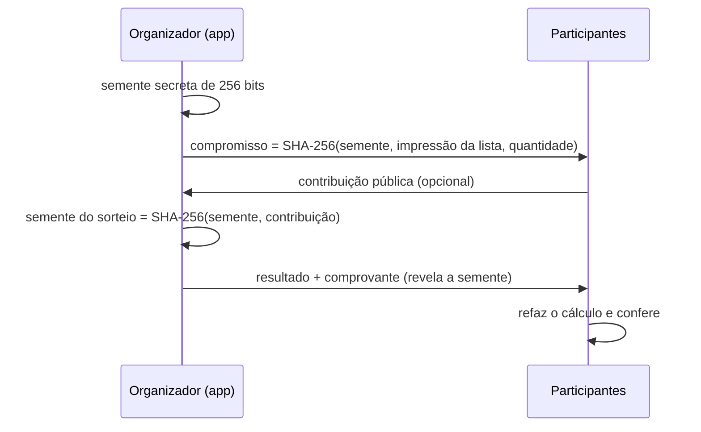

# Sorteador

**Português** · [English](README.en.md) · [Abrir Sorteador](https://acamilateixeira.github.io/sorteador-web/)

[](https://github.com/acamilateixeira/sorteador-web/actions/workflows/pages.yml)

**Sorteio de nomes ou números que roda no navegador e pode ser auditado.** Num sorteio comum, quem participa precisa confiar em quem organiza. Aqui o organizador publica um compromisso antes de sortear, e depois qualquer pessoa confere pelo comprovante que a lista, a quantidade e o resultado não foram trocados.

`Angular 22` · `TypeScript` · `Signals` · `Web Crypto (SHA-256)` · `Vitest` · `GitHub Actions`

## Como usar

1. Escolha **Nomes** e cole um nome por linha, ou escolha **Números** e informe um intervalo.
2. Defina a quantidade por rodada. Cada rodada traz resultados diferentes entre si.
3. Deixe **Excluir resultados anteriores deste conjunto** marcado para continuar sorteando da mesma lista sem repetir. **Nova sequência** limpa o resultado e o histórico.
4. Clique em **Sortear agora**. As rodadas anteriores ficam no painel de resultado enquanto a página estiver aberta.

### Com auditoria

1. Marque **Sorteio auditável** e clique em **Gerar compromisso**.
2. Divulgue o código de compromisso aos participantes, por exemplo na tela ou no chat.
3. Peça a alguém do público uma palavra ou um número e digite em **Contribuição dos participantes**.
4. Clique em **Sortear e revelar**. O resultado sai com o comprovante, que pode ser copiado como link ou baixado em JSON.
5. Quem quiser conferir abre o link ou cola o comprovante em **03 / Verificação**.

## Como a auditoria funciona



- **Compromisso.** Prende a lista e a quantidade antes do sorteio. Se a lista ou a quantidade mudar depois, o app descarta o compromisso e pede um novo.
- **Contribuição pública.** Como a semente é gerada no navegador de quem organiza, ele poderia gerar vários compromissos até achar um resultado conveniente. A contribuição chega depois do compromisso publicado e entra na semente, o que impede essa escolha.
- **Sorteio determinístico.** Blocos `SHA-256(semente:contador)` viram inteiros de 32 bits. Valores que causariam viés de módulo são descartados, e os inteiros alimentam um Fisher-Yates parcial. A mesma semente sempre produz o mesmo resultado.
- **Verificação.** O app refaz o cálculo a partir do comprovante e mostra duas checagens:

| Adulteração | O que a verificação acusa |
| --- | --- |
| Lista, quantidade ou semente trocadas | O compromisso não confere |
| Contribuição ou resultado alterados | O sorteio refeito dá outro resultado |

### Limites da auditoria

- **Alcance do comprovante.** Ele serve para verificação técnica do sorteio. Não constitui certificação oficial nem substitui a autorização exigida para promoções comerciais no Brasil. [Ministério da Fazenda](https://www.gov.br/pt-br/servicos/obter-autorizacao-para-atividades-de-distribuicao-gratuita-de-premios-a-titulo-de-propaganda-ou-de-captacao-de-poupanca-popular)
- O compromisso só tem valor se for divulgado **antes** do sorteio.
- A contribuição precisa vir de alguém que não seja o organizador.
- **O comprovante contém a lista inteira.** Só compartilhe o link onde a lista puder ser vista por todos. Ele leva o comprovante no fragmento (`#`), que o navegador não envia ao servidor, mas fica no histórico e em qualquer lugar onde o link for colado.
- Listas grandes não cabem num link (limite de 8.000 caracteres). Nesse caso, use **Baixar comprovante** e compartilhe o arquivo.

## Arquitetura

| Parte | Responsabilidade |
| --- | --- |
| [`src/app/draw.ts`](src/app/draw.ts) | Regras de entrada (até 5.000 nomes, intervalos de até 100.000 números, até 200 por rodada) e o sorteio comum com `crypto.getRandomValues`, sem viés de módulo. |
| [`src/app/audit.ts`](src/app/audit.ts) | Compromisso, contribuição, sorteio determinístico, comprovante, link e verificação. Usa só Web Crypto, sem dependências. |
| [`src/app/app.ts`](src/app/app.ts) | Componente Angular com Reactive Forms e signals. Controla as rodadas, a exclusão de resultados, os dois passos da auditoria e o painel de verificação. |
| [`.github/workflows/pages.yml`](.github/workflows/pages.yml) | Roda os testes e o build a cada PR e publica no GitHub Pages a cada merge na `main`. |

Tudo roda no navegador. A página é publicada como arquivos estáticos, e listas e resultados não saem do dispositivo, a menos que você compartilhe o comprovante.

## Testes

São 18 testes com Vitest:

- **Regras de entrada e sorteio comum:** nomes duplicados e linhas vazias, intervalos inválidos e quantidade impossível.
- **Motor auditável:**
  - um resultado fixo de referência, que garante que comprovantes antigos continuem verificáveis;
  - a uniformidade do sorteio;
  - a contribuição alterando a semente;
  - comprovantes que sobrevivem ao link;
  - um caso para cada tipo de adulteração.
- **Componente:**
  - rodadas sem repetição;
  - a mensagem de opções restantes;
  - o fluxo de compromisso e revelação;
  - o compromisso descartado quando a lista muda;
  - a verificação por link.

## Rodar localmente

Use Node.js 22.22.3 ou superior na série 22. [Compatibilidade do Angular](https://angular.dev/reference/versions)

```bash
npm ci
npm start
```

Abra `http://localhost:4200`. Para rodar os testes e o build:

```bash
npm test -- --watch=false
npm run build
```

## Postman, Insomnia e verificação

Importe a [coleção Sorteador](docs/postman.collection.json) para verificar a resposta HTML da demo. Para validar a lógica, use `npm test -- --watch=false` e, no navegador, sorteie duas vezes com a opção de excluir resultados anteriores. Para conferir o servidor local, ajuste `baseUrl` para `http://localhost:4200` e `pagePath` para `/`. No modo auditável, gere o comprovante, valide no verificador e altere um campo para conferir que o arquivo modificado é rejeitado.
